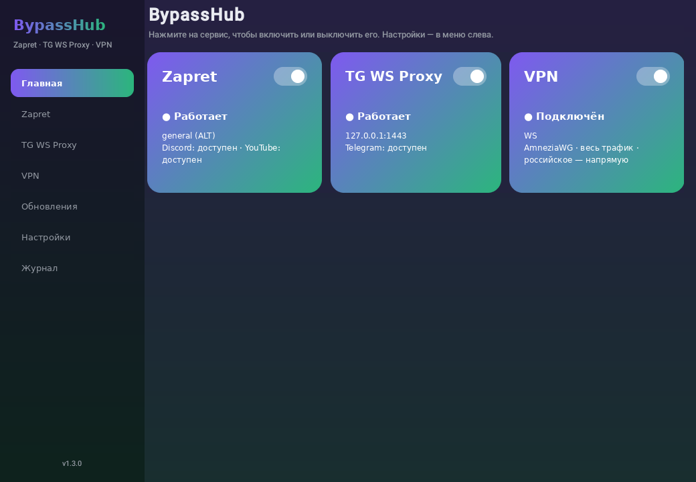
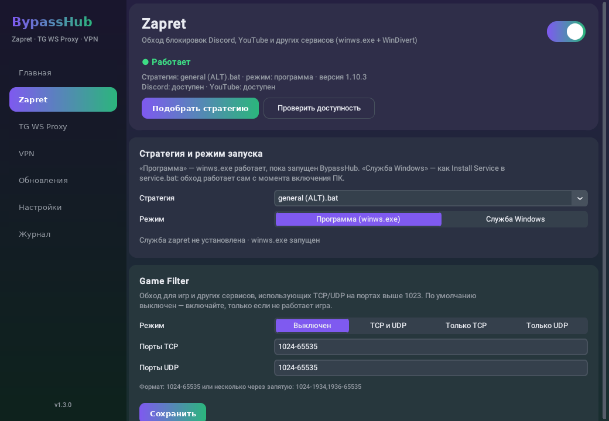
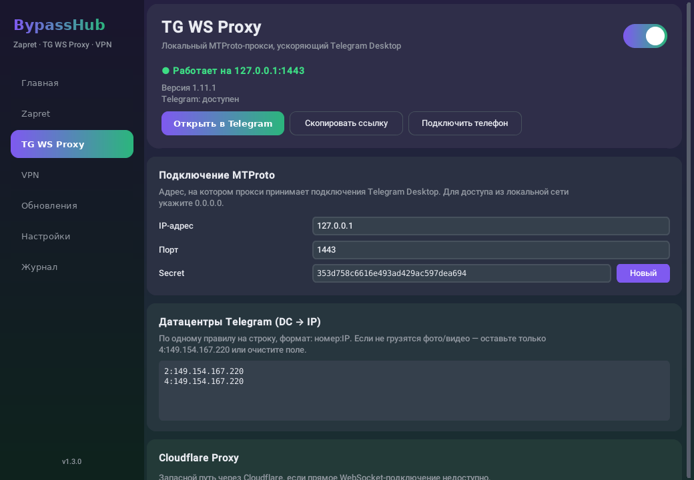
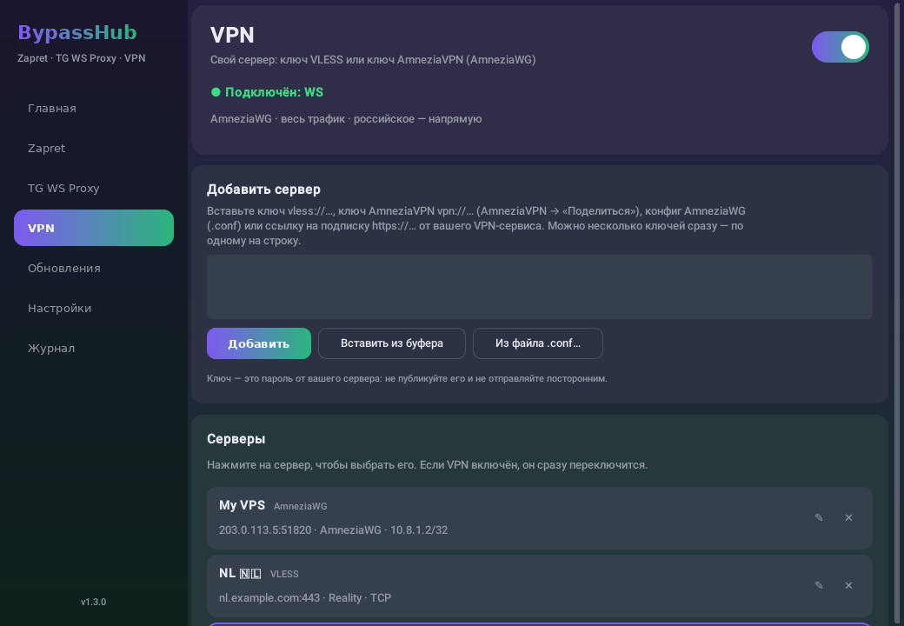
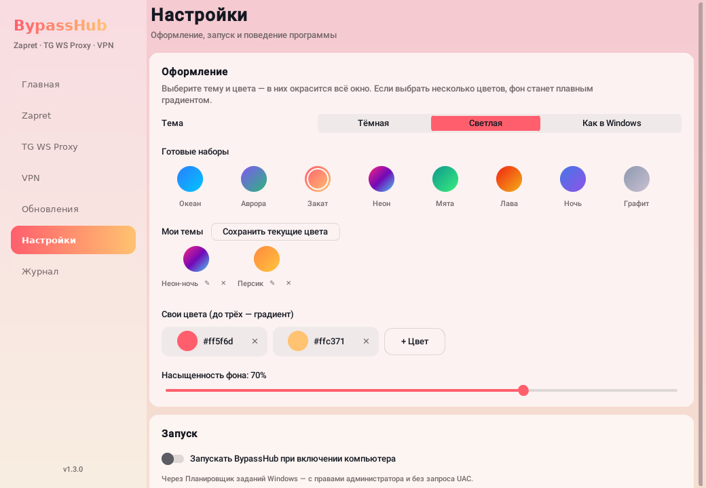
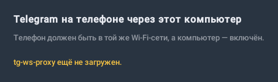

<div align="center">

# BypassHub

**Zapret, TG WS Proxy и свой VPN в одной программе: три кнопки — и всё работает, а обновляется само.**

[](https://github.com/Miffk/BypassHub/releases/latest)
[](https://github.com/Miffk/BypassHub/releases)


[](https://github.com/Miffk/BypassHub/actions/workflows/bypasshub.yml)

**[⬇ Скачать для Windows](https://github.com/Miffk/BypassHub/releases/latest/download/BypassHub.exe)** &nbsp;·&nbsp; **[⬇ Скачать для Linux](https://github.com/Miffk/BypassHub/releases/latest/download/BypassHub-linux-x86_64)** &nbsp;·&nbsp; **[⬇ Скачать для Android](https://github.com/Miffk/BypassHub/releases/latest/download/BypassHub-android.apk)** &nbsp;·&nbsp; **[⬇ Скачать для iOS](https://github.com/Miffk/BypassHub/releases/latest/download/BypassHub-ios.ipa)**

<sub>iOS-версия ставится только с вашим сертификатом через ESign, Sideloadly и т. п. — см. [iPhone и iPad](#iphone-и-ipad)</sub>

<sub>Все версии и история изменений — на странице [Releases](https://github.com/Miffk/BypassHub/releases)</sub>



</div>

BypassHub — программа для Windows, которая собирает в одном окне три инструмента:

| | Что делает |
|---|---|
| **Zapret** | Обход замедления и блокировок Discord, YouTube и других сайтов — на основе [zapret-discord-youtube](https://github.com/Flowseal/zapret-discord-youtube). Без VPN и без сторонних серверов. |
| **TG WS Proxy** | Локальный MTProto-прокси [tg-ws-proxy](https://github.com/Flowseal/tg-ws-proxy), который ускоряет Telegram на компьютере и, при желании, на телефоне. |
| **VPN** | Свой VPN по ключу **VLESS** или ключу **AmneziaVPN** (AmneziaWG) — с раздельным туннелированием: зарубежное идёт через VPN, российское — напрямую. |

На главной — три большие кнопки: нажали, и сервис включился. Все настройки каждого сервиса — на его странице
в меню слева. Не нужно запускать `.bat`-файлы, искать новые версии на GitHub и переносить свои списки после
обновления: BypassHub делает это сам.

Есть и **[версия для Linux](#linux)** (делалась под CachyOS с KDE Plasma): то же окно, те же три кнопки.
И **[версия для Android](#android)** — для телефонов, планшетов и Android TV: обход блокировок без VPN,
TG WS Proxy и тот же VPN с раздельным туннелированием, root не нужен. И **[версия для iPhone и iPad](#iphone-и-ipad)** —
то же самое на iOS (ставится со своим сертификатом).

## Содержание

- [Возможности](#возможности)
- [Скриншоты](#скриншоты)
- [Установка и первый запуск](#установка-и-первый-запуск)
- [VPN и раздельное туннелирование](#vpn-и-раздельное-туннелирование)
- [Linux](#linux)
- [Android](#android)
- [iPhone и iPad](#iphone-и-ipad)
- [Telegram на телефоне](#telegram-на-телефоне)
- [Вопросы и проблемы](#вопросы-и-проблемы)
- [Где хранятся данные](#где-хранятся-данные)
- [Безопасность](#безопасность)
- [Сборка из исходников](#сборка-из-исходников)
- [Благодарности и лицензии](#благодарности-и-лицензии)
- [Поддержать проект](#поддержать-проект)

## Возможности

### Главная — три кнопки

- **Zapret**, **TG WS Proxy** и **VPN** включаются и выключаются одним нажатием на кнопку. Включённая кнопка
  подсвечивается цветами темы.
- На каждой кнопке — состояние сервиса и доступность Discord, YouTube и Telegram. Доступность проверяется каждые
  3 минуты и после каждого переключения.
- Переключать сервисы можно и **из трея**, и **горячими клавишами** — даже когда окно свёрнуто.
- **Автозапуск** при включении компьютера (через Планировщик заданий Windows, без окна UAC при каждом входе).
  Программа запоминает, что было включено, и включает это снова после перезагрузки.

### Zapret — всё, что умеет `service.bat`, но кнопками

- **Автоподбор стратегии**: программа по очереди пробует все стратегии, проверяет сайты по TLS 1.2 и 1.3
  и предлагает лучшую — применить её можно одной кнопкой.
- Выбор стратегии (`general*.bat`) и режима запуска: **«Программа»** (winws работает, пока открыт BypassHub)
  или **«Служба Windows»** (как *Install Service* — обход работает даже без BypassHub).
- **Game Filter** (вкл/выкл, TCP/UDP, диапазоны портов) и **IPSet Filter** (none / loaded / any), обновление IPSet-списка.
- Замена активных фейков (Discord UDP, Game Filter UDP).
- **Исключение программ**: Steam, Epic Games, Battle.net, Riot, EA, Ubisoft, FACEIT, Xbox — их домены не попадают под обход,
  чтобы магазины и игры не ломались. Можно добавить свои домены и включить экспериментальное «обучение» по IP-адресам.
- Редактор пользовательских списков (`list-general-user.txt`, `list-exclude-user.txt`, `ipset-exclude-user.txt`).
- Обновление файла `hosts`, диагностика (поиск конфликтующих служб, очистка кэша Discord), тест стратегий, удаление служб.

### TG WS Proxy — все настройки в одном окне

- Кнопки **«Открыть в Telegram»** (прокси добавляется в Telegram Desktop в один клик), **«Скопировать ссылку»**
  и **«Подключить телефон»** (QR-код для Telegram на телефоне).
- Все параметры прокси: адрес и порт, secret, соответствие DC → IP, Cloudflare-прокси (HTTP/2, свой домен),
  Cloudflare Worker, подробный журнал, размер буфера и пула, размер лога, тестовые DC.

### VPN — свой сервер

- Подходят **ключ VLESS** (`vless://…`), **ключ AmneziaVPN** (`vpn://…`), конфиг **AmneziaWG** (`.conf`)
  и **ссылка на подписку** VPN-сервиса. Подписки **обновляются сами** — при запуске и каждые несколько часов
  (или как просит сам сервис), так что новые серверы появляются в списке без нажатия кнопки. Обновить вручную —
  кнопка «⟳ Обновить серверы» на главной или «⟳ Обновить подписки» на странице VPN.
- **Несколько серверов**: список с пингом — на главной и на странице VPN. Сервер выбирается одним нажатием,
  а между серверами VLESS VPN переключается на лету, без переподключения.
- **«Авто — лучший сервер»**: BypassHub раз в минуту проверяет задержку всех серверов VLESS, подключается к самому
  быстрому и сам переходит на другой, если сервер перестал отвечать. Видно, какой сервер используется сейчас.
- **Раздельное туннелирование**: зарубежное — через VPN, российское — напрямую с домашнего IP
  (подробнее — [ниже](#vpn-и-раздельное-туннелирование)).
- Два режима: **«Весь трафик»** — через VPN идут все программы, включая игры, — или **«Системный прокси»** —
  только браузеры и программы, которые учитывают настройки прокси Windows.
- **Программы мимо VPN**: игры, в которых через VPN растёт пинг (Dota 2, CS2, Valorant, League of Legends,
  Fortnite), загрузки Steam и любые свои программы можно пустить напрямую, не выключая VPN. Отмечаются галочками
  на странице VPN; свою программу можно выбрать по её `.exe`.
- Работает на официальных движках [sing-box](https://github.com/SagerNet/sing-box) (VLESS: Reality, TLS, WebSocket,
  gRPC, HTTPUpgrade) и [клиенте AmneziaWG](https://github.com/amnezia-vpn/amneziawg-windows-client) (AmneziaWG,
  включая протокол 3.1). Они скачиваются при первом включении VPN и дальше обновляются сами.
- Пинг серверов: когда VPN включён — реальная задержка через сам сервер, когда выключен — время подключения
  к серверу. Обновление подписок, переименование серверов, лог VPN.

### Обновления

- BypassHub сам следит за новыми версиями на GitHub: zapret, tg-ws-proxy, sing-box, клиент AmneziaWG и базы
  раздельного туннелирования. Проверка — при запуске и каждые 6 часов (интервал настраивается).
- Новые версии скачиваются и **проверяются по SHA-256**, который публикует GitHub.
- Ваши настройки zapret (списки, Game Filter, IPSet, фейки, свои стратегии) **переносятся в новую версию**,
  работающий сервис перезапускается сам. Старые версии и временные файлы удаляются.
- **Самообновление**: сама программа тоже обновляется из [релизов](https://github.com/Miffk/BypassHub/releases)
  этого репозитория — скачивает новый `BypassHub.exe`, подменяет себя и перезапускается.

### Оформление

- Тёмная, светлая или «как в Windows».
- Готовые наборы цветов и **свои цвета** (до трёх): всё окно окрашивается плавным градиентом.
  Ползунок «Насыщенность фона» регулирует силу окраски.
- Удобное окно выбора цвета: квадрат насыщенности/яркости, полоса оттенка, HEX, быстрые цвета — изменения видны сразу.
- **«Мои темы»** — созданные сочетания цветов сохраняются, их можно выбрать одним кликом, переименовать или удалить.
- Тема меняется на лету, с плавным переходом, без перезапуска.

### Горячие клавиши

Работают в любой программе, даже когда окно свёрнуто в трей:

| Действие | По умолчанию |
|---|---|
| Zapret вкл/выкл | `Ctrl+Alt+Z` |
| TG WS Proxy вкл/выкл | `Ctrl+Alt+T` |
| VPN вкл/выкл | `Ctrl+Alt+V` |
| Показать/скрыть окно | `Ctrl+Alt+B` |
| Проверить доступность сервисов | не задано |

Любое сочетание меняется в «Настройках» (нажать на него и затем новые клавиши), каждое можно отключить,
а можно выключить все сразу. Если сочетание уже занято другой программой, BypassHub об этом скажет.
Когда окно скрыто, результат переключения показывается уведомлением.

### Прочее

- **Резервная копия**: экспорт и импорт всех настроек (BypassHub, zapret, TG WS Proxy, серверы VPN) в один
  JSON-файл — удобно при переустановке Windows. В файле будут и ключи VPN — храните его как пароль.
- **Журнал** событий прямо в программе.

## Скриншоты

<table>
  <tr>
    <td align="center"><br><sub>Zapret: переключатель, стратегия и все настройки</sub></td>
    <td align="center"><br><sub>TG WS Proxy</sub></td>
  </tr>
  <tr>
    <td align="center"><br><sub>VPN: серверы VLESS и AmneziaWG</sub></td>
    <td align="center"><br><sub>Светлая тема и свои цвета</sub></td>
  </tr>
</table>

## Установка и первый запуск

1. Скачайте `BypassHub.exe` со страницы **[Releases](https://github.com/Miffk/BypassHub/releases/latest)**.
   Положите его в любую удобную папку (например, `C:\Programs\BypassHub`) — установка не нужна.
2. Запустите. Windows попросит права администратора: они нужны драйверу WinDivert, на котором работает zapret,
   а также для служб, файла `hosts` и сетевого адаптера VPN.
3. При первом запуске BypassHub сам скачает последние версии zapret и tg-ws-proxy.
4. На главной нажмите **Zapret**. Если Discord или YouTube не открываются — откройте Zapret в меню слева
   и нажмите **«Подобрать стратегию»**: программа найдёт рабочую стратегию для вашего провайдера.
5. Нажмите **TG WS Proxy**, затем на его странице — **«Открыть в Telegram»**: Telegram Desktop предложит добавить прокси.
6. Если у вас есть свой VPN-сервер — добавьте ключ на странице VPN и нажмите **VPN** на главной
   (см. [раздел про VPN](#vpn-и-раздельное-туннелирование)).
7. По желанию: в «Настройках» включите автозапуск, чтобы всё работало сразу после включения компьютера.

> [!TIP]
> Если Windows Defender или другой антивирус ругается на zapret — это ожидаемо, см. [вопросы](#вопросы-и-проблемы).

## VPN и раздельное туннелирование


**Как подключить**

1. Откройте **VPN** в меню слева и вставьте ключ: `vless://…` от вашего VPN-сервиса, ключ AmneziaVPN `vpn://…`
   (в AmneziaVPN: сервер → «Поделиться») или ссылку на подписку. Конфиг AmneziaWG можно выбрать файлом `.conf`.
2. Нажмите **VPN** на главной. При первом включении BypassHub скачает нужный движок — это несколько секунд.
   Если серверов несколько, под кнопками появится их список с пингом: выберите сервер или
   **«⚡ Авто — лучший сервер»**.
3. Если открыт AmneziaVPN или другой VPN-клиент — сначала отключитесь в нём.

**Раздельное туннелирование** (включено по умолчанию)

- через VPN идёт всё зарубежное;
- напрямую, с домашнего IP, идут сайты `.ru`, `.рф`, `.su` со всеми поддоменами, российские IP-адреса и российские
  сервисы на «нерусских» доменах (vk.com, userapi.com, yastatic.net, банки и т. д.) — по базам
  [roscomvpn](https://github.com/hydraponique/roscomvpn-routing);
- YouTube, Telegram, GitHub и Google Play всегда идут через VPN, даже если их сервер оказался на российском IP.

Российский трафик вообще не попадает на VPN-сервер: банки и Госуслуги видят обычный домашний адрес, а сервер
не тратит трафик. Базы обновляются автоматически.

Для AmneziaWG это работает так: туннель AmneziaWG поднимается без своих маршрутов, а sing-box решает, что отправить
в туннель, а что — напрямую. Если раздельное туннелирование выключить, через VPN идёт весь трафик, как в AmneziaVPN.

> [!IMPORTANT]
> Ключ VPN — это пароль от вашего сервера. Не публикуйте его и не пересылайте. Если ключ попал в чужие руки,
> удалите этого пользователя на сервере (в AmneziaVPN — «Поделиться» → список пользователей) и создайте новый ключ.

<br clear="right">

## Linux

Версия для Linux — тот же BypassHub с тем же окном. Делалась под **CachyOS** (KDE Plasma, Wayland), должна работать
и на других дистрибутивах x86_64 (Arch, EndeavourOS, Fedora, Ubuntu…).

**Установка:**

```bash
mkdir -p ~/Applications && cd ~/Applications
curl -LO https://github.com/Miffk/BypassHub/releases/latest/download/BypassHub-linux-x86_64
chmod +x BypassHub-linux-x86_64
./BypassHub-linux-x86_64
```

После первого запуска BypassHub появится в меню приложений (его можно закрепить на панели), а программа будет
обновляться сама. Окно работает от имени пользователя; когда нужны права администратора — для zapret, VPN
«Весь трафик», файла `/etc/hosts` или службы systemd, — система **один раз за сеанс** спросит пароль (pkexec).

**Чем отличается от Windows:**

| | Windows | Linux |
|---|---|---|
| Zapret | winws.exe + WinDivert | **nfqws** из [bol-van/zapret](https://github.com/bol-van/zapret) + правила nftables (или iptables). Стратегии, списки и фейки — те же, из zapret-discord-youtube |
| Режим «служба» | служба Windows | служба **systemd** `bypasshub-zapret` — обход работает с момента включения компьютера, без BypassHub и без пароля |
| TG WS Proxy | TgWsProxy.exe | официальные исходники того же релиза; прокси запускается встроенным Python BypassHub, без окна и значка в трее |
| VPN VLESS / Hysteria2 | sing-box | sing-box; «Системный прокси» прописывается в настройки KDE Plasma и GNOME |
| VPN AmneziaWG | клиент скачивается сам | встроен в BypassHub (то же ядро, что в версии для Android), ставить ничего не нужно |
| Горячие клавиши | задаются в программе | назначаются в системе на команду `BypassHub-linux-x86_64 --action toggle_zapret` (команды — в «Настройках») |
| Автозапуск | Планировщик заданий | ярлык в `~/.config/autostart` |
| Данные | `C:\ProgramData\BypassHub` | `~/.local/share/BypassHub` |

Для zapret нужен **nftables** (если его нет — `sudo pacman -S nftables`) или iptables.
Если включён брандмауэр ufw или firewalld, при «Подключить телефон» BypassHub сам откроет порт прокси.

> [!NOTE]
> «Тест в PowerShell» из zapret-discord-youtube есть только в Windows — в Linux для подбора стратегии
> используйте кнопку **«Подобрать стратегию»**.

## Android

BypassHub для Android работает на телефонах, планшетах и Android TV (Android 7.0 и новее), root не нужен.

- **обход блокировок без VPN**: YouTube, Discord, Twitch и другие сайты из списков zapret открываются напрямую —
  приложение разбивает начало защищённого соединения, и провайдер не видит, какой сайт открывается.
  Шесть способов, в том числе «Подставной пакет» и «Внеполосный байт» для мобильного интернета. Помогает не у всех
  операторов — см. [«На мобильном интернете не работает обход или TG-прокси»](#вопросы-и-проблемы);
- **TG WS Proxy** — Telegram через WebSocket прямо на телефоне, без VPN; включается одной кнопкой и подключается
  к Telegram в один шаг. Если оператор не пропускает к адресам Telegram, прокси идёт через Cloudflare;
- **VPN** по ключам VLESS и AmneziaVPN / AmneziaWG — те же ключи, что и в версии для Windows;
- **раздельное туннелирование** по тем же правилам: зарубежное — через VPN, российское — напрямую;
- несколько серверов: пинг, выбор сервера и **«Авто»** — подключение к лучшему;
- плитка в шторке быстрых настроек, ссылки `vless://` и `vpn://` открываются прямо в приложении;
- на телевизоре — значок в лаунчере Android TV и управление пультом;
- обновляется само.

**Установка:** скачайте [BypassHub-android.apk](https://github.com/Miffk/BypassHub/releases/latest/download/BypassHub-android.apk),
откройте и разрешите установку. На главной нажмите **Обход блокировок** — настраивать ничего не нужно. Для своего
VPN вставьте ключ на вкладке **VPN** и нажмите **VPN** на главной.
На телевизор APK удобно передать с телефона через Send Files to TV или флешку.

Обход и VPN работают по очереди: Android разрешает только одно VPN-подключение. Голосовые звонки Discord без VPN
не ускоряются. Подробнее — в [Android/README.md](Android/README.md).

## iPhone и iPad

BypassHub для iOS (iOS 15 и новее) умеет то же, что версия для Android: **обход блокировок без VPN**, **TG WS Proxy**
и **VPN** по ключам VLESS и AmneziaVPN с раздельным туннелированием. На iPhone все три можно включить одновременно:
сайты из списков обхода (YouTube, Discord…) идут напрямую с обходом, остальное — через VPN.

> **Важно:** приложения нет в App Store, и просто так IPA-файл на iPhone не установить. Его нужно подписать
> **своим сертификатом** (файлы `.p12` и `.mobileprovision`) в программе для установки — **ESign**, Sideloadly,
> zsign или похожей. В профиле сертификата должно быть право **Network Extensions** (`packet-tunnel-provider`) —
> без него iOS не даст создать VPN. Если сертификата нет, установить iOS-версию не получится.

**Установка:**

1. Скачайте [BypassHub-ios.ipa](https://github.com/Miffk/BypassHub/releases/latest/download/BypassHub-ios.ipa).
2. Подпишите его своим сертификатом в ESign (или Sideloadly, zsign). **Не удаляйте плагины/расширения** — VPN
   работает во встроенном расширении `BypassHub Tunnel`.
3. Установите и откройте BypassHub. При первом включении iOS попросит разрешение добавить VPN-конфигурацию.

Само iOS-приложение не обновляется: новую версию скачайте из Releases и подпишите так же — серверы и настройки
сохранятся. Файл `.p12` и пароль от него никому не отправляйте. Подробнее — в [iOS/README.md](iOS/README.md).

## Telegram на телефоне

Прокси, запущенный на компьютере, может ускорять Telegram и на телефоне в той же Wi-Fi-сети:



1. Откройте **TG WS Proxy** в меню слева и нажмите **«Подключить телефон»**.
2. BypassHub откроет прокси для домашней сети и сам добавит правило в брандмауэр Windows.
3. Наведите камеру телефона на QR-код, откройте ссылку — запустится Telegram.
4. Нажмите «Подключить прокси».

Адрес компьютера выбирается автоматически: адаптеры VPN и виртуальных машин пропускаются.
Если на компьютере включён сторонний VPN, программа предупредит — он может мешать подключению.
Кнопка **«Отключить доступ»** закрывает прокси для сети и удаляет правило брандмауэра.

<br clear="right">

## Вопросы и проблемы

<details>
<summary><b>Антивирус удаляет winws.exe или WinDivert</b></summary>

zapret работает через драйвер WinDivert, который перехватывает сетевые пакеты, — поэтому некоторые антивирусы
помечают его как «потенциально нежелательную программу» (HackTool / RiskTool). Это ложное срабатывание:
BypassHub скачивает только официальные релизы zapret-discord-youtube и проверяет их контрольную сумму.
Добавьте папку `C:\ProgramData\BypassHub` в исключения антивируса.
</details>

<details>
<summary><b>Discord или YouTube всё равно не работают</b></summary>

- Нажмите «Подобрать стратегию» на странице Zapret — разным провайдерам подходят разные стратегии.
- На странице Zapret откройте диагностику: она найдёт конфликтующие службы (другие копии zapret, GoodbyeDPI и т. п.)
  и может очистить кэш Discord.
- Убедитесь, что не запущен другой zapret или GoodbyeDPI — одновременно работать может только один.
- Обновите IPSet-список и файл `hosts` на странице Zapret.
</details>

<details>
<summary><b>На мобильном интернете не работает обход или TG-прокси (Android, iPhone)</b></summary>

Обход без VPN обманывает только проверку **имени сайта**. Домашние провайдеры обычно ограничиваются ею,
а мобильные операторы часто строже — поэтому на Wi-Fi всё может работать, а на мобильном интернете нет.

- Попробуйте в «Обход → Способ» **«Подставной пакет»** (только Android) и **«Внеполосный байт»** — они рассчитаны
  на мобильные сети. Заодно включите **«Применять ко всем сайтам»**: так отключается QUIC.
- Если не помог ни один способ, оператор режет нужные серверы **по адресам**. Так бывает с видеосерверами YouTube:
  страница и превью загружаются, а видео — нет. Без VPN-сервера это не обойти: добавьте ключ VLESS или AmneziaVPN
  на вкладке VPN — с раздельным туннелированием YouTube пойдёт через сервер, российские сайты — напрямую.
- **TG WS Proxy:** если оператор не пропускает к адресам Telegram (в журнале — `dial tcp 149.154.167.220:443:
  i/o timeout`), прокси сам переходит на Cloudflare-прокси (с версии 1.6.5). Если и они не отвечают (в журнале —
  ошибки `Cloudflare-прокси …`), на этой сети прокси работать не будет — нужен VPN.
- Если на мобильном интернете не открываются вообще никакие сайты, кроме российских, у оператора включены
  «белые списки». Тогда не помогут ни обход, ни прокси, а VPN — только если сервер находится в разрешённой сети.
</details>

<details>
<summary><b>Перестали работать игры или Steam</b></summary>

На странице Zapret отметьте нужные программы в «Исключениях» или выключите Game Filter.
zapret работает на уровне сетевых пакетов и не знает, какой программе принадлежит пакет, поэтому исключение
программы — это исключение её доменов (и, в экспериментальном режиме, IP-адресов, к которым она подключена).
</details>

<details>
<summary><b>Нужен ли zapret, если включён VPN?</b></summary>

Обычно нет: с VPN зарубежные сайты и так открываются. Zapret полезен без VPN — например, если VPN-сервера нет или
не хочется гонять YouTube через сервер. Если при включённых zapret и VPN что-то перестало открываться,
выключите zapret.
</details>

<details>
<summary><b>С VPN лагает игра (Dota 2, CS2 и др.)</b></summary>

На странице VPN в разделе **«Программы мимо VPN»** отметьте игру (или укажите её `.exe` через «Выбрать…»).
Игра пойдёт напрямую, а всё остальное — через VPN, выключать его не нужно. Работает в режиме «Весь трафик»;
в режиме «Системный прокси» игры и так идут мимо VPN.
</details>

<details>
<summary><b>VPN не подключается</b></summary>

- Если открыт AmneziaVPN, Hiddify, v2rayN или другой VPN — отключите его: два VPN одновременно мешают друг другу.
- Ключи VLESS с транспортом XHTTP пока не поддерживаются движком sing-box — попросите у VPN-сервиса ключ
  с TCP (Reality), WebSocket или gRPC.
- Ошибки подключения видны во вкладке «Журнал» и в логе VPN (кнопка «Лог VPN» на странице VPN).
- Если какой-то сайт не открывается при раздельном туннелировании, выключите его на странице VPN — тогда через VPN
  пойдёт весь трафик.
</details>

<details>
<summary><b>Телефон не подключается к прокси</b></summary>

- Телефон и компьютер должны быть в одной Wi-Fi-сети (не в гостевой — там устройства изолированы).
- Выключите сторонний VPN на компьютере и VPN на телефоне.
- Проверьте, что в окне «Подключить телефон» выбран адрес домашней сети (обычно `192.168.x.x`).
</details>

<details>
<summary><b>Как удалить BypassHub</b></summary>

1. Выключите VPN, в «Настройках» выключите автозапуск, а на странице Zapret удалите службы
   (если включали режим «Служба Windows»).
2. Закройте программу через значок в трее → «Выход».
3. Удалите `BypassHub.exe` и папку `C:\ProgramData\BypassHub`.
</details>

## Где хранятся данные

Все данные лежат в `C:\ProgramData\BypassHub` (в Linux — `~/.local/share/BypassHub`) — путь без кириллицы и вне
OneDrive, так zapret работает надёжнее:

```
C:\ProgramData\BypassHub\
  settings.json     настройки BypassHub (в том числе серверы VPN)
  zapret\           релиз zapret-discord-youtube с вашими списками и настройками
  tgwsproxy\        TgWsProxy.exe + TgWsProxy_data\config.json (портативный режим)
  vpn\sing-box\     sing-box.exe, config.json и базы раздельного туннелирования
  vpn\amneziawg\    amneziawg.exe и конфиг туннеля
  logs\             bypasshub.log, winws.log, vpn.log
```

Папку можно сменить параметром `--data-dir` или переменной окружения `BYPASSHUB_DATA`.

## Безопасность

- BypassHub скачивает только **официальные релизы** с GitHub и сверяет их SHA-256 с тем, что публикует GitHub.
- Сам `BypassHub.exe` собирается **GitHub Actions** из исходников этого репозитория — сборку любого релиза можно
  проследить во вкладке [Actions](https://github.com/Miffk/BypassHub/actions/workflows/bypasshub.yml).
- Программа не собирает и не отправляет никаких данных. В сеть она обращается только к GitHub (обновления),
  к проверяемым сайтам — Discord, YouTube, Telegram и т. п. (проверка доступности и подбор стратегии) — и к вашим
  VPN-серверам и подпискам.
- Ключи VPN хранятся только у вас, в `C:\ProgramData\BypassHub\settings.json`.
- Права администратора нужны только для zapret (драйвер WinDivert), служб Windows, файла `hosts`, правила брандмауэра
  и сетевого адаптера VPN.
- В Linux окно работает от имени пользователя, а действия с правами root выполняет помощник, которого запускает
  pkexec: он принимает только свои команды (правила перехвата, запуск nfqws и sing-box из папки BypassHub, `/etc/hosts`,
  служба `bypasshub-zapret`) и завершается вместе с окном.

## Сборка из исходников

Нужны Windows и Python 3.10+:

```bat
git clone https://github.com/Miffk/BypassHub.git
cd BypassHub\BypassHub
build.bat
```

Готовый файл — `dist\BypassHub.exe`. Запуск без сборки: `pip install -r requirements.txt` и `python main.py`.
Тесты: `python -m pytest`. Подробности для разработчиков — в [BypassHub/README.md](BypassHub/README.md).

В Linux: `cd BypassHub/BypassHub && ./build.sh` — получится `dist/BypassHub-linux-x86_64`. Запуск без сборки — так же,
`pip install -r requirements.txt` и `python main.py`.

Версия для Android (Go + Kotlin) собирается в GitHub Actions; как собрать её самому — в [Android/README.md](Android/README.md).
Версия для iOS (то же ядро на Go + SwiftUI) — тоже в GitHub Actions, без подписи; сборка — в [iOS/README.md](iOS/README.md).

## Благодарности и лицензии

- [zapret](https://github.com/bol-van/zapret) — **bol-van**, и сборка [zapret-discord-youtube](https://github.com/Flowseal/zapret-discord-youtube) — **Flowseal** (MIT);
- [tg-ws-proxy](https://github.com/Flowseal/tg-ws-proxy) — **Flowseal** (MIT);
- [WinDivert](https://github.com/basil00/WinDivert) — **basil00**;
- [sing-box](https://github.com/SagerNet/sing-box) — **SagerNet** (GPL-3.0);
- [AmneziaWG для Windows](https://github.com/amnezia-vpn/amneziawg-windows-client) и [amneziawg-go](https://github.com/amnezia-vpn/amneziawg-go) — **Amnezia** (MIT);
- базы раздельного туннелирования [roscomvpn](https://github.com/hydraponique/roscomvpn-routing) — **hydraponique**;
- интерфейс — [CustomTkinter](https://github.com/TomSchimansky/CustomTkinter).

BypassHub для Windows не содержит кода zapret, tg-ws-proxy, sing-box и AmneziaWG: он скачивает их официальные
релизы с GitHub авторов. Версия для Android включает sing-box и amneziawg-go в своё ядро и поэтому распространяется
по лицензии [GPL-3.0](Android/LICENSE). Все права на эти проекты принадлежат их авторам.

> [!NOTE]
> Программа предназначена для восстановления доступа к сервисам, которые замедляет или блокирует ваш провайдер.
> Пользуйтесь ею в соответствии с законодательством вашей страны.

## Поддержать проект

BypassHub бесплатный и без рекламы. Если программа вам помогает, можно поддержать её развитие — буду очень благодарен! ❤️

<div align="center">

**[💜 Поддержать на DonationAlerts](https://www.donationalerts.com/r/m1ffk)**

</div>
